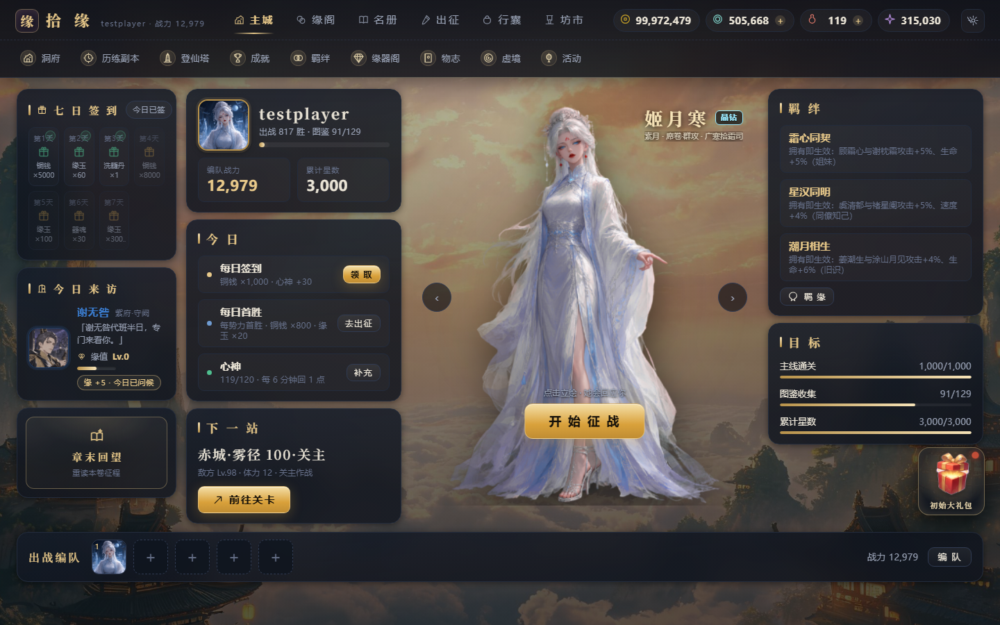

# 拾缘 · Jieyuan

> 一款数据驱动的东方仙侠卡牌游戏。回合制 ATB 战斗 × 角色养成 × 剧情探索 × 限时活动。

[](CHANGELOG.md)
[](LICENSE)
[](package.json)
[](#-快速开始)

---

## 📖 简介

**拾缘** 是一款以东方仙侠为世界观的卡牌 RPG。玩家扮演「拾缘人」，在九州六域间收集缘卡、结识仙友、追索身世，并在登仙塔、材料副本与限时活动中不断变强。

游戏采用**数据驱动架构**：

- `content/` 是唯一的人工编辑源（角色、技能、关卡、经济、剧情、配音……全部是 JSON / Markdown / 图片）
- `data/` 是由 `npm run build` 生成的运行时产物
- 战斗数值只在 **C# 战斗引擎**中实现，前端只负责演出，保证「描述 = 实际结算」
- 经济与养成只在 `tools/lib/game.mjs` 中实现，杜绝前后端两套公式

一条数据 + 一张立绘即可新增角色，无需改动任何代码。

## ✨ 游戏特色

| 系统 | 说明 |
|---|---|
| **角色收集** | 129 名角色，晶钻 / 红阶 / 金阶 / 紫阶 / 蓝阶 / 绿阶六档稀有度，六气属性与七大战斗定位 |
| **回合战斗** | ATB 行动条 + 技能 fx 原语系统，终结技 / 被动 / 助战技全部由数据驱动 |
| **主线剧情** | 1000 关主线 + 12 个材料副本，章节场景与剧情 CV 全量配音 |
| **卡池抽卡** | 多卡池轮换、UP 机制、软保底与硬保底、翻牌演出 |
| **缘系统** | 角色专属天赋链（0~6 缘）、缘器、本命签与升缘养成 |
| **登仙塔** | 1000 层无尽塔，按稀有度递增的里程碑奖励 |
| **限时活动** | 活动关卡、活动积分、活动商店与日常/周常任务 |
| **家园与日常** | 庄园、日常任务、七日签到、每日商城、图鉴（万妖谱） |
| **在线后端** | Node.js 账号/存档/订单服务，MySQL 持久化，管理后台可配卡池与 BGM |

## 🖼 游戏截图

| 登录界面 | 游戏主界面 |
|---|---|
|  |  |

> 截图取自 v0.1.0 实机运行。

## 🚀 快速开始

### 环境要求

| 依赖 | 版本 | 说明 |
|---|---|---|
| Node.js | **≥ 18** | 服务端、构建与规则引擎 |
| MySQL | **8.x** | 账号 / 存档 / 订单 / 后台配置 |
| .NET SDK | **8.0**（仅开发编译战斗引擎需要） | Release 包已自带 self-contained 运行时，部署无需安装 |

### 本地启动

```bash
# 1. 安装依赖
npm install

# 2. 构建内容（content/ -> data/）
npm run build

# 3. 编译战斗引擎（首次或改动 C# 后执行；需要 .NET 8 SDK）
npm run core

# 4. 启动服务
npm run serve
# 打开 http://localhost:5174
```

> 数据库默认连接 `root:root@127.0.0.1:3306/shiyuan_web`，见 `config/database.json`。
> 首次启动会自动建库建表，也可以手动执行 `npm run db:init`。

Windows 用户也可以直接双击 **`start.bat`**：脚本会自动安装依赖、构建内容并启动服务。

### 常用命令

| 命令 | 作用 |
|---|---|
| `npm run build` | `content/` → `data/` 内容构建 |
| `npm run validate` | 内容一致性校验 |
| `npm run serve` | 启动本地服务（默认 5174 端口） |
| `npm run test:web` | 接口 / 安全 / 流程测试 |
| `npm run core` | 编译并自检 C# 战斗引擎 |
| `npm run check` | 构建 + 校验 + 引擎自检 |
| `npm run package` | 构建发布包到 `release/` |
| `npm run package:zip` | 构建发布包并压缩成 zip |

## 📦 发布与部署

### 下载首发版本

**v0.1.0 首个版本** 已发布在 [GitHub Releases](https://github.com/lisboy/jieyuan/releases/tag/v0.1.0)。

由于完整发布包超过 GitHub 单文件 2 GiB 限制，压缩包被拆分为多个分卷：

1. 下载 `release-0.1.0.zip.part01` 与 `release-0.1.0.zip.part02`（以及 `SHA256SUMS.txt`）
2. 合并分卷：
   - **Windows (cmd)**：`copy /b release-0.1.0.zip.part01+release-0.1.0.zip.part02 release-0.1.0.zip`
   - **Linux / macOS**：`cat release-0.1.0.zip.part* > release-0.1.0.zip`
3. 校验并解压：
   ```bash
   sha256sum -c SHA256SUMS.txt    # Windows 可用 certutil -hashfile release-0.1.0.zip SHA256
   unzip release-0.1.0.zip -d shiyuan
   ```
4. 按发布包内 `README.txt` 部署（`npm install --omit=dev` → 配置数据库 → `start.cmd` / `start.sh`）

### 自己打包

```bash
npm run package:zip        # 含 C# 编译 + 内容校验
npm run release            # 跳过 C# 编译，复用现有 bin/Release
```

发布包结构：

```
release/
├─ web/                 前端静态资源
├─ data/                构建产物（角色档案 + 美术 + 关卡）
├─ content/             剧情与新手教学（运行时直读）
├─ config/              数据库配置与 schema.sql
├─ tools/               服务端与规则引擎
├─ engine/              C# 战斗引擎（self-contained）
├─ package.json         生产依赖
├─ start / stop / restart 脚本（cmd + sh）
├─ README.txt           服务器部署速查
├─ VERSION.txt          版本 + 构建信息
└─ MANIFEST.txt         文件清单与关键文件 SHA256
```

部署细节（MySQL 配置、pm2/systemd、Nginx 反代、升级与备份）见 [docs/DEPLOY.md](docs/DEPLOY.md)。

## 🗂 项目结构

```
content/                     人工编辑源
  roster.json                角色主数据（129 名）
  stages.json                关卡配置（主线 1000 关）
  economy.json               经济与养成参数
  gacha.json                 卡池与保底
  story.json                 主线剧情（含 CV 台词）
  events/                    限时活动配置
  art/<角色名>-<id>/          角色立绘源图
data/                        构建产物（勿手改，由 npm run build 生成）
  characters/<id>/           角色档案 + 立绘 + 卡面
  index.json                 名册索引
  config.json                规则表归档
web/                         浏览器前端（原生 JS，经典脚本）
  index.html / style.css
  js/                        游戏逻辑与界面
  art/ bg/ audio/            前端资源
src/
  Shiyuan.Core/              C# 战斗数值核心
  Shiyuan.ContentIO/         JSON 内容读取层
  Shiyuan.Core.Runner/       战斗引擎宿主（battle-repl 进程池）
tools/
  serve.mjs                  HTTP 服务端（账号 / 存档 / 战斗 API）
  build.mjs                  content -> data 构建
  validate.mjs               内容一致性校验
  lib/game.mjs               经济与养成规则（单点真相）
  package.mjs                发布打包
docs/                        架构、部署、美术、角色创建等文档
config/                      数据库配置与建表 DDL
```

架构与数据流详见 [docs/ARCHITECTURE.md](docs/ARCHITECTURE.md)，开发手册见 [docs/DEV-GUIDE.md](docs/DEV-GUIDE.md)，新增角色全流程见 [docs/CHARACTER-CREATION.md](docs/CHARACTER-CREATION.md)。

## 🛠 技术栈

- **前端**：原生 JavaScript（经典脚本、无框架）、HTML5、CSS3，CSP 安全策略
- **服务端**：Node.js 原生 HTTP 服务（`tools/serve.mjs`）、MySQL（`mysql2`）
- **战斗引擎**：C# / .NET 8（`Shiyuan.Core.Runner`，进程池 + JSON 通信）
- **测试**：Node.js 接口测试 + jsdom 前端测试 + CDP 真实浏览器验收
- **打包**：`tools/package.mjs`（自包含引擎 + 一键 zip）

## 🧪 验证

```bash
npm run validate            # 内容一致性校验（关卡/角色/资产）
npm run test:web            # 接口与流程测试（需先启动服务）
```

## 🎯 开发约定

1. **`content/` 是唯一人工编辑源，`data/` 是产物**——不要手改 `data/`。
2. **战斗数值只在 C# 中实现**——前端不写第二套战斗公式。
3. **经济与养成只在 `tools/lib/game.mjs`**——其他代码不算钱。
4. 前端为经典脚本，动态 HTML 必须 `esc()` 转义，CSP 禁止内联事件。

更多约定见 [AGENTS.md](AGENTS.md)。

## 📚 文档索引

| 文档 | 内容 |
|---|---|
| [docs/ARCHITECTURE.md](docs/ARCHITECTURE.md) | 分层架构与数据流 |
| [docs/DEV-GUIDE.md](docs/DEV-GUIDE.md) | 编码 / 构建 / 部署实操 |
| [docs/DEPLOY.md](docs/DEPLOY.md) | 生产部署完整手册 |
| [docs/CHARACTER-CREATION.md](docs/CHARACTER-CREATION.md) | 从零新建角色全链路 |
| [docs/WEB.md](docs/WEB.md) | Web 版说明 |
| [docs/BALANCE-REPORT.md](docs/BALANCE-REPORT.md) | 数值平衡报告 |

## 📄 License

本项目使用 [Apache License 2.0](LICENSE)。

---

**拾缘 · 愿每一次相遇，都是久别重逢。**
